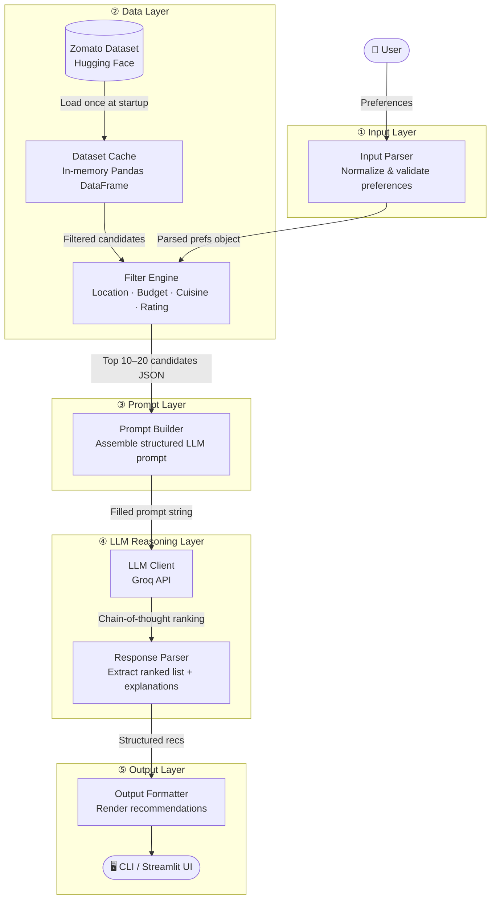
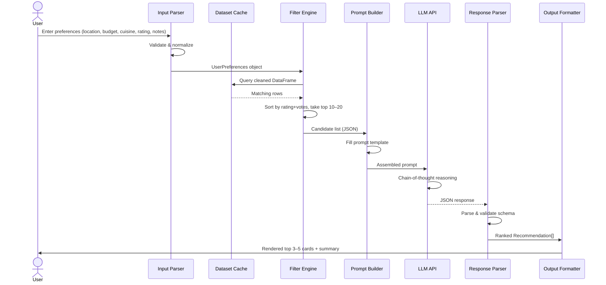
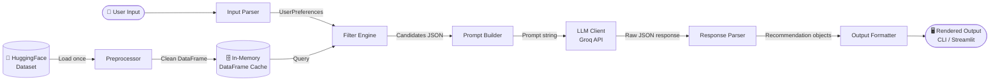
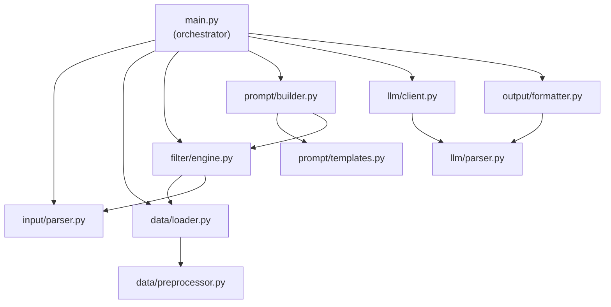

# System Architecture: AI-Powered Restaurant Recommendation System

> **Project Codename:** Zomato-1  
> **Document Type:** Detailed Architecture  
> **Last Updated:** 2026-11-14

---

## 1. Architecture Overview

The system follows a **linear pipeline architecture** with five distinct layers. Data flows in one direction — from user input through data retrieval, to LLM reasoning, and finally to formatted output. There is no persistent user state in the PoC; each request is stateless and self-contained.



---

## 2. Component Breakdown

### 2.1 Input Layer

**Responsibility:** Accept raw user input, validate it, and emit a clean, typed `UserPreferences` object used by all downstream components.

```
┌────────────────────────────────────────────────────┐
│                   Input Parser                     │
│                                                    │
│  Raw Input (CLI args / form fields / free-text)    │
│          │                                         │
│          ▼                                         │
│  ┌─────────────────┐   ┌──────────────────────┐   │
│  │ Structured Fields│   │ Free-text NLP        │   │
│  │ location        │   │ (optional — simple   │   │
│  │ budget (enum)   │   │  keyword extraction  │   │
│  │ cuisine         │   │  from extra_prefs)   │   │
│  │ min_rating      │   └──────────────────────┘   │
│  └────────┬────────┘            │                  │
│           └────────────┬────────┘                  │
│                        ▼                           │
│              UserPreferences object                │
│  { location, budget_tier, cuisine, min_rating,     │
│    extra_prefs_text, raw_query }                   │
└────────────────────────────────────────────────────┘
```

**Key responsibilities:**
- Normalize city names (e.g., `"bangalore"` → `"Bangalore"`, `"blr"` → `"Bangalore"`)
- Map budget strings to numeric ranges: `low` → `< 400`, `medium` → `400–1000`, `high` → `> 1000`
- Default optional fields: cuisine → `"Any"`, min_rating → `3.0`
- Validate required fields and raise user-friendly errors

**Output contract:**
```python
@dataclass
class UserPreferences:
    location: str           # Normalized city name
    budget_tier: str        # "low" | "medium" | "high"
    budget_range: tuple     # (min_cost, max_cost) in ₹
    cuisine: str            # Cuisine type or "Any"
    min_rating: float       # Minimum acceptable rating
    extra_prefs: str        # Free-text optional notes
    raw_query: str          # Original user input (for LLM context)
```

---

### 2.2 Data Layer

**Responsibility:** Load the dataset once, hold it in memory, and provide fast filtered candidate lists on demand.

```
┌──────────────────────────────────────────────────────────┐
│                       Data Layer                         │
│                                                          │
│  ┌────────────────────────────────────┐                  │
│  │  Dataset Loader (startup, once)    │                  │
│  │                                    │                  │
│  │  HuggingFace datasets.load_dataset │                  │
│  │      ↓                             │                  │
│  │  Raw DataFrame (all rows)          │                  │
│  │      ↓                             │                  │
│  │  Preprocessor                      │                  │
│  │  • Drop nulls (name/location/      │                  │
│  │    rating)                         │                  │
│  │  • Add budget_tier column          │                  │
│  │  • Normalize cuisine tags          │                  │
│  │  • Drop votes < 10                 │                  │
│  │      ↓                             │                  │
│  │  Clean DataFrame (in-memory cache) │                  │
│  └────────────┬───────────────────────┘                  │
│               │                                          │
│               ▼                                          │
│  ┌────────────────────────────────────┐                  │
│  │  Filter Engine (per request)       │                  │
│  │                                    │                  │
│  │  Stage 1 — Hard filters (AND):     │                  │
│  │    • city == preferences.location  │                  │
│  │    • budget_tier == pref.budget    │                  │
│  │    • rating >= pref.min_rating     │                  │
│  │    • cuisine contains pref.cuisine │                  │
│  │      (if cuisine != "Any")         │                  │
│  │                                    │                  │
│  │  Stage 2 — Soft sort:              │                  │
│  │    • Sort by rating DESC,          │                  │
│  │      then votes DESC               │                  │
│  │                                    │                  │
│  │  Stage 3 — Take top N (10–20)      │                  │
│  │                                    │                  │
│  │  Stage 4 — Fallback:               │                  │
│  │    If 0 results → relax budget,    │                  │
│  │    then relax cuisine, then        │                  │
│  │    return "no match" message       │                  │
│  └────────────┬───────────────────────┘                  │
│               │                                          │
│               ▼                                          │
│       Candidate List (JSON array, ≤20 items)             │
└──────────────────────────────────────────────────────────┘
```

**Data schema (cleaned record):**

```python
{
  "name": "Truffles",
  "location": "Koramangala",
  "city": "Bangalore",
  "cuisines": ["American", "Continental"],
  "cost_for_two": 600,
  "budget_tier": "medium",
  "rating": 4.5,
  "votes": 2300,
  "has_online_delivery": True,
  "has_table_booking": False,
  "restaurant_type": "Casual Dining"
}
```

**Fallback strategy:**
```
Exact match → 0 results?
    ↓ Relax budget tier (adjacent tier)
    ↓ Still 0? Relax cuisine to "Any"
    ↓ Still 0? Return nearest city matches
    ↓ Still 0? Return "No restaurants found" error
```

---

### 2.3 Prompt Layer

**Responsibility:** Assemble a well-structured, deterministic prompt that gives the LLM all the context it needs to reason and rank.

**Prompt Template Structure:**

```
┌──────────────────────────────────────────────────┐
│  SYSTEM PROMPT (static, set once)               │
│  "You are a restaurant recommendation expert... │
│   Always reason before ranking.                 │
│   Return output ONLY in this JSON schema: ..."  │
├──────────────────────────────────────────────────┤
│  USER PROMPT (dynamic, per request)             │
│                                                  │
│  ## User Preferences                            │
│  - Location: {location}                         │
│  - Budget: {budget_tier} (₹{min}–₹{max})        │
│  - Cuisine: {cuisine}                           │
│  - Minimum Rating: {min_rating}                 │
│  - Additional preferences: {extra_prefs}        │
│                                                  │
│  ## Restaurant Candidates                       │
│  [Markdown table or JSON array of ≤20 records]  │
│                                                  │
│  ## Task                                        │
│  1. Reason step-by-step about each candidate.  │
│  2. Rank them from best to worst fit.           │
│  3. Return the top 3–5 as structured JSON.      │
│  4. For each, write a 2–3 sentence explanation. │
└──────────────────────────────────────────────────┘
```

**Token budget management:**
- System prompt: ~300 tokens (fixed)
- User preferences: ~100 tokens
- Candidate data: ~50 tokens × N candidates = ~500–1000 tokens for 10–20 candidates
- Task instructions: ~150 tokens
- **Total input: ~1000–1600 tokens** (well within context limits)
- Expected output: ~600–900 tokens (top 5 recs with explanations)

---

### 2.4 LLM Reasoning Layer

**Responsibility:** Call the LLM API, receive the response, parse it into a structured list of ranked recommendations, and handle API errors gracefully.

```
┌──────────────────────────────────────────────────────────┐
│                  LLM Reasoning Layer                     │
│                                                          │
│  ┌─────────────────────────────┐                        │
│  │  LLM Client (abstracted)    │                        │
│  │                             │                        │
│  │  Primary:  Groq API          │                        │
│  │  Model: llama-3.1-70b-versatile│                        │
│  │                             │                        │
│  │  Config:                    │                        │
│  │  • temperature = 0.3        │  (deterministic rank)  │
│  │  • max_tokens = 1200        │                        │
│  │  • response_format = JSON   │                        │
│  └──────────────┬──────────────┘                        │
│                 │                                        │
│                 ▼                                        │
│  ┌─────────────────────────────┐                        │
│  │  Response Parser            │                        │
│  │                             │                        │
│  │  • Parse JSON from response │                        │
│  │  • Validate schema fields   │                        │
│  │  • Handle malformed JSON    │                        │
│  │    (regex fallback)         │                        │
│  │  • Cap at top 5 results     │                        │
│  └──────────────┬──────────────┘                        │
│                 │                                        │
│                 ▼                                        │
│  ┌─────────────────────────────┐                        │
│  │  Error Handler              │                        │
│  │                             │                        │
│  │  • API rate limit → retry   │                        │
│  │    with exponential backoff │                        │
│  │  • Timeout → return top-N   │                        │
│  │    by rating (no LLM)       │                        │
│  │  • Parse fail → re-prompt   │                        │
│  │    once, then fallback      │                        │
│  └─────────────────────────────┘                        │
└──────────────────────────────────────────────────────────┘
```

**LLM Output Schema (enforced via system prompt):**

```json
{
  "recommendations": [
    {
      "rank": 1,
      "name": "Truffles",
      "location": "Koramangala, Bangalore",
      "cuisines": ["American", "Continental"],
      "rating": 4.5,
      "votes": 2300,
      "cost_for_two": 600,
      "budget_tier": "medium",
      "restaurant_type": "Casual Dining",
      "has_online_delivery": true,
      "has_table_booking": false,
      "explanation": "Top pick for your budget and location...",
      "trade_offs": "Slightly popular so waits at peak hours."
    }
  ],
  "summary": "Here are the top 3 picks for a medium-budget family lunch in Bangalore."
}
```

---

### 2.5 Output Layer

**Responsibility:** Render the structured recommendations into human-friendly output, adapted for CLI or UI.

```
┌──────────────────────────────────────────────────────────┐
│                     Output Layer                         │
│                                                          │
│  Structured Recommendations JSON                         │
│         │                                               │
│         ▼                                               │
│  ┌─────────────────────────────┐                        │
│  │  Output Formatter           │                        │
│  │                             │                        │
│  │  CLI mode:                  │                        │
│  │    Rich terminal formatting │                        │
│  │    (colored text, tables)   │                        │
│  │                             │                        │
│  │  UI mode (Streamlit):       │                        │
│  │    Cards with icons,        │                        │
│  │    expandable sections      │                        │
│  └─────────────────────────────┘                        │
│                                                          │
│  Sample CLI output per card:                            │
│  ┌────────────────────────────────────────────────┐     │
│  │ 🍽️  #1 — Truffles  (Casual Dining)             │     │
│  │    📍 Koramangala, Bangalore                   │     │
│  │    🍕 American, Continental                    │     │
│  │    ⭐ 4.5 / 5   (2,300 votes)                  │     │
│  │    💰 ~₹600 · Medium budget                    │     │
│  │    🛵 Delivery: Yes  |  📅 Booking: No         │     │
│  │    🤖 Why: Highly rated comfort food spot...   │     │
│  │       Trade-off: Can get crowded on weekends.  │     │
│  └────────────────────────────────────────────────┘     │
└──────────────────────────────────────────────────────────┘
```

---

## 3. Full Request Lifecycle



---

## 4. Data Flow Diagram



---

## 5. Module & File Structure

```
zomato-1/
│
├── docs/
│   ├── problemstatement.md       # Problem definition & objectives
│   └── architecture.md           # This document
│
├── src/
│   ├── __init__.py
│   │
│   ├── data/
│   │   ├── __init__.py
│   │   ├── loader.py             # HuggingFace dataset loading & caching
│   │   └── preprocessor.py      # Cleaning, normalization, budget bucketing
│   │
│   ├── input/
│   │   ├── __init__.py
│   │   └── parser.py             # UserPreferences dataclass + validation
│   │
│   ├── filter/
│   │   ├── __init__.py
│   │   └── engine.py             # Hard filter + soft sort + fallback logic
│   │
│   ├── prompt/
│   │   ├── __init__.py
│   │   ├── builder.py            # Prompt assembly logic
│   │   └── templates.py          # System + user prompt templates
│   │
│   ├── llm/
│   │   ├── __init__.py
│   │   ├── client.py             # Groq abstracted client
│   │   └── parser.py             # Response JSON parsing + fallback
│   │
│   ├── output/
│   │   ├── __init__.py
│   │   └── formatter.py          # CLI renderer (Rich) + Streamlit cards
│   │
│   └── main.py                   # Entry point — wires all layers together
│
├── app.py                        # Streamlit UI entry point (stretch goal)
│
├── tests/
│   ├── test_parser.py
│   ├── test_filter.py
│   ├── test_prompt.py
│   └── test_llm_parser.py
│
├── .env.example                  # API key template
├── requirements.txt
└── README.md
```

---

## 6. Configuration & Environment

| Variable | Description | Required |
|---|---|---|
| `GROQ_API_KEY` | Groq API key | Yes |
| `LLM_PROVIDER` | `"groq"` | No (defaults to `groq`) |
| `LLM_TEMPERATURE` | Sampling temperature | No (defaults to `0.3`) |
| `MAX_CANDIDATES` | Max candidates passed to LLM | No (defaults to `15`) |
| `TOP_N_RESULTS` | Max results returned to user | No (defaults to `5`) |
| `HF_DATASET_NAME` | HuggingFace dataset identifier | No (defaults to hardcoded) |

**`.env.example`:**
```env
GROQ_API_KEY=your_key_here
LLM_PROVIDER=groq
LLM_TEMPERATURE=0.3
MAX_CANDIDATES=15
TOP_N_RESULTS=5
```

---

## 7. Error Handling & Edge Cases

| Scenario | Handling Strategy |
|---|---|
| No restaurants match filters | Fallback: relax budget → relax cuisine → user-friendly "no results" message |
| LLM API rate limit | Exponential backoff (3 retries), then fallback to rating-sorted list |
| LLM returns malformed JSON | Regex extraction of ranked names, then re-prompt once |
| LLM API timeout (> 15s) | Return top-N candidates sorted by rating, with no explanation |
| Dataset load failure | Fatal error with clear message — dataset is required |
| Invalid user input | Validation error returned immediately before any API call |

---

## 8. Interface Variants

### 8.1 CLI (PoC — Primary)

```
$ python src/main.py

📍 Location: Bangalore
💰 Budget (low/medium/high): medium
🍕 Cuisine (or press Enter for any): Italian
⭐ Minimum rating (default 3.0): 4.0
📝 Any other preferences? (optional): quiet, good for a date

🔍 Searching... found 14 candidates.
🤖 Asking AI to rank and explain...

━━━━━━━━━━━━━━━━━━━━━━━━━━━━━━━━━━━━━━━━━━━━
🍽️  #1 — Fenny's Lounge & Kitchen
...
```

### 8.2 Streamlit UI (Stretch Goal)

```
┌─────────────────────────────────────────────────┐
│  🍽️ Zomato AI Recommender                      │
├───────────────┬─────────────────────────────────┤
│  FILTERS      │  RESULTS                        │
│               │                                 │
│  City         │  ┌───────────────────────────┐  │
│  [Bangalore▼] │  │ #1 Fenny's Lounge  ⭐4.6  │  │
│               │  │ 📍 Indiranagar     💰₹800  │  │
│  Budget       │  │ 🍕 Italian, Mediterranean │  │
│  [Medium  ▼]  │  │                           │  │
│               │  │ 🤖 Perfect for a quiet    │  │
│  Cuisine      │  │ dinner... [read more]     │  │
│  [Italian   ] │  └───────────────────────────┘  │
│               │                                 │
│  Min Rating   │  ┌───────────────────────────┐  │
│  [4.0      ]  │  │ #2 Toscano          ⭐4.4  │  │
│               │  │ ...                       │  │
│  Notes        │  └───────────────────────────┘  │
│  [quiet, date]│                                 │
│               │                                 │
│  [🔍 Search]  │                                 │
└───────────────┴─────────────────────────────────┘
```

---

## 9. Non-Functional Requirements

| NFR | Target | Implementation |
|---|---|---|
| **Latency** | < 10s end-to-end | Filter is in-memory Pandas (< 100ms); LLM dominates |
| **Accuracy** | ≥ 90% filter correctness | Hard filter unit tested against known data |
| **Reliability** | LLM failure → graceful fallback | Rating-sorted result without AI explanation |
| **Maintainability** | Modular, one-concern-per-module | Separate `src/` modules per layer |
| **Cost** | Minimize LLM tokens | Pre-filter to ≤ 20 candidates before LLM call |
| **Portability** | Run on any machine with Python 3.10+ | No local ML model needed; pure API-based |

---

## 10. Dependency Graph



---

## 11. Technology Decisions & Rationale

| Decision | Choice | Rationale |
|---|---|---|
| **Dataset loading** | HuggingFace `datasets` | Native integration with the target dataset; handles caching automatically |
| **Data manipulation** | Pandas | Fast in-memory filtering; familiar to most Python devs; no DB overhead for PoC |
| **LLM provider** | Groq API | Ultra-fast inference; free tier available; OpenAI-compatible SDK |
| **LLM abstraction** | Custom thin wrapper | Allows swapping LLM providers without changing upstream code |
| **LLM temperature** | 0.3 | Lower = more deterministic ranking; avoids creative but wrong orderings |
| **Prompt format** | Candidates as JSON in prompt | Structured data reduces LLM parsing effort vs. prose descriptions |
| **CLI framework** | Python `rich` | Easy colored tables and panels with zero JS dependency |
| **UI framework** | Streamlit (stretch goal) | Minimal code for data-driven UIs; no frontend expertise required |
| **Config** | `python-dotenv` + `.env` | Simple, secure, standard approach for API key management |
