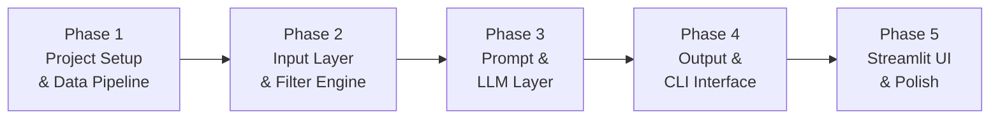
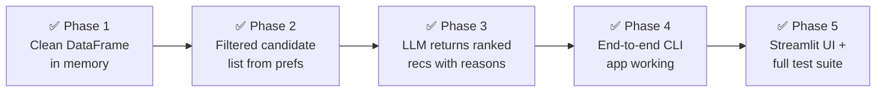

# Phase-wise Implementation Plan: AI-Powered Restaurant Recommendation System

> **Project Codename:** Zomato-1  
> **Document Type:** Implementation Plan  
> **Last Updated:** 2026-11-14  
> **References:** `architecture.md` · `problemstatement.md`

---

## Overview

The project is broken into **5 phases**, each building directly on the previous. Each phase ends in a working, testable milestone. No phase requires the next one to be meaningful.



| Phase | Focus Area | Key Deliverable | Est. Effort |
|---|---|---|---|
| 1 | Project setup & data pipeline | Clean dataset loaded in memory | 1–2 days |
| 2 | Input parsing & filter engine | Filtered candidate list from preferences | 1–2 days |
| 3 | Prompt builder & LLM integration | Ranked recommendations from LLM | 1–2 days |
| 4 | Output formatter & CLI wiring | End-to-end working CLI app | 1 day |
| 5 | Streamlit UI & hardening | Polished web UI + error handling | 1–2 days |

---

## Phase 1 — Project Setup & Data Pipeline

**Goal:** Establish the project skeleton, dev environment, and a clean, in-memory restaurant dataset ready for querying.

### 1.1 Repository & Environment Setup

- [ ] Create project directory structure as defined in `architecture.md §5`
- [ ] Initialize `requirements.txt` with core dependencies:
  ```
  datasets          # HuggingFace data loader
  pandas            # DataFrame operations
  python-dotenv     # .env config
  groq              # Groq SDK
  rich              # CLI formatting
  streamlit         # UI (Phase 5)
  pytest            # Testing
  ```
- [ ] Create `.env.example` with all variables from `architecture.md §6`
- [ ] Create `src/__init__.py` and all sub-package `__init__.py` files
- [ ] Set up `pytest` with a base `tests/` directory

**Exit criteria:** `pip install -r requirements.txt` succeeds cleanly.

---

### 1.2 Dataset Loader (`src/data/loader.py`)

Load the HuggingFace dataset and return a raw Pandas DataFrame.

```python
# Interface to implement
def load_dataset() -> pd.DataFrame:
    """
    Load Zomato dataset from HuggingFace Hub.
    Returns raw DataFrame. Caches locally on first run.
    """
```

- [ ] Use `datasets.load_dataset("ManikaSaini/zomato-restaurant-recommendation")`
- [ ] Convert to Pandas DataFrame via `.to_pandas()`
- [ ] Log row count and column names on load
- [ ] Handle `ConnectionError` (no internet) with clear fatal message

**Test:** `test_loader.py` — assert DataFrame is non-empty and has expected columns.

---

### 1.3 Preprocessor (`src/data/preprocessor.py`)

Clean and enrich the raw DataFrame. This runs once at startup and the result is held in memory for all requests.

```python
# Interface to implement
def preprocess(df: pd.DataFrame) -> pd.DataFrame:
    """
    Clean, normalize, and enrich raw dataset.
    Returns cleaned DataFrame ready for filtering.
    """
```

**Transformations:**

| Step | Logic |
|---|---|
| Drop null rows | Drop where `name`, `city`, or `aggregate_rating` is null |
| Drop low-signal rows | Drop where `votes` < 10 |
| Normalize city names | `.str.strip().str.title()` on `city` column |
| Normalize cuisines | Split comma-separated string → list, lowercase, strip whitespace |
| Add `budget_tier` column | `low` if cost < 400, `medium` if 400–1000, `high` if > 1000 |
| Rename columns | Standardize to snake_case (`aggregate_rating` → `rating`, etc.) |
| Reset index | Clean integer index after dropping rows |

- [ ] Implement each transformation as a private `_step()` function for testability
- [ ] Log how many rows were dropped at each step

**Test:** `test_preprocessor.py` — assert budget tiers are correct, no nulls in key columns, cuisine field is a list type.

---

### Phase 1 Milestone ✅

> Running `python -c "from src.data.loader import load_dataset; from src.data.preprocessor import preprocess; df = preprocess(load_dataset()); print(df.shape)"` prints a valid row/column count.

---

## Phase 2 — Input Parsing & Filter Engine

**Goal:** Accept user preferences, validate them, and produce a filtered shortlist of candidate restaurants from the dataset.

### 2.1 Input Parser (`src/input/parser.py`)

Define the `UserPreferences` dataclass and the parsing/validation logic.

```python
@dataclass
class UserPreferences:
    location: str
    budget_tier: str          # "low" | "medium" | "high"
    budget_range: tuple       # (min_cost, max_cost)
    cuisine: str              # cuisine name or "Any"
    min_rating: float         # 0.0 – 5.0
    extra_prefs: str          # free-text
    raw_query: str            # original unmodified input string

def parse_preferences(raw: dict) -> UserPreferences:
    """Validate and normalize raw user input dict."""
```

**Validation rules:**

| Field | Rule |
|---|---|
| `location` | Required; strip + title-case; reject if empty |
| `budget_tier` | Must be one of `low`, `medium`, `high`; case-insensitive |
| `cuisine` | Optional; default `"Any"`; strip whitespace |
| `min_rating` | Optional; default `3.0`; clamp to `0.0–5.0` |
| `extra_prefs` | Optional; default `""`; truncate to 200 chars |

**City alias mapping** (expand over time):
```python
CITY_ALIASES = {
    "blr": "Bangalore", "bengaluru": "Bangalore",
    "del": "Delhi", "new delhi": "Delhi",
    "mum": "Mumbai", "bombay": "Mumbai",
    # ...
}
```

- [ ] Implement `parse_preferences()` with clear `ValueError` messages
- [ ] Implement city alias normalization
- [ ] Implement budget tier → range mapping:
  - `low` → `(0, 400)`
  - `medium` → `(400, 1000)`
  - `high` → `(1000, 999999)`

**Test:** `test_parser.py` — test valid inputs, alias normalization, missing required field, out-of-range rating, case-insensitive budget.

---

### 2.2 Filter Engine (`src/filter/engine.py`)

Apply hard filters, sort, and return top-N candidates. Implements the 4-stage strategy from `architecture.md §2.2`.

```python
def get_candidates(
    df: pd.DataFrame,
    prefs: UserPreferences,
    max_candidates: int = 15
) -> list[dict]:
    """
    Filter restaurant DataFrame by preferences.
    Returns list of restaurant dicts, sorted by rating then votes.
    """
```

**Implementation — 4 stages:**

```
Stage 1: Hard filter
    df[df.city == prefs.location]
    df[df.budget_tier == prefs.budget_tier]
    df[df.rating >= prefs.min_rating]
    df[df.cuisines.apply(lambda c: prefs.cuisine.lower() in c)]  # if not "Any"

Stage 2: Sort
    .sort_values(["rating", "votes"], ascending=False)

Stage 3: Take top N
    .head(max_candidates)

Stage 4: Fallback (if Stage 1 returns 0 rows)
    → Relax budget_tier (try adjacent tiers: medium→low+high)
    → Still 0? Set cuisine = "Any" and retry
    → Still 0? Return empty list with fallback_triggered=True flag
```

- [ ] Implement all 4 stages with clear separation
- [ ] Return `{"candidates": [...], "fallback_triggered": bool, "fallback_reason": str}`
- [ ] Convert result rows to plain `dict` (JSON-serializable)
- [ ] Log how many candidates matched at each fallback stage

**Test:** `test_filter.py` — test exact match, cuisine fallback, budget fallback, full no-match, sort order correctness.

---

### Phase 2 Milestone ✅

> Running the filter engine with sample preferences prints a JSON list of matching restaurants from the real dataset.

---

## Phase 3 — Prompt Builder & LLM Integration

**Goal:** Turn the candidate list + preferences into a prompt, call the LLM, and parse the response into structured recommendations.

### 3.1 Prompt Templates (`src/prompt/templates.py`)

Store all prompt strings as constants. No logic here — just text.

```python
SYSTEM_PROMPT = """
You are an expert restaurant recommendation assistant.
You will be given a user's dining preferences and a list of restaurant candidates.

Your task:
1. Reason step-by-step about how well each restaurant fits the user's needs.
2. Rank the restaurants from best to worst fit.
3. Return ONLY a valid JSON object matching this exact schema:

{
  "recommendations": [
    {
      "rank": <integer>,
      "name": <string>,
      "explanation": <2-3 sentence string explaining why this is a good fit>,
      "trade_offs": <1 sentence string or empty string>
    }
  ],
  "summary": <1-2 sentence overall summary string>
}

Return the top 3 to 5 restaurants only. Do not include any text outside the JSON.
"""

USER_PROMPT_TEMPLATE = """
## User Preferences
- Location: {location}
- Budget: {budget_tier} (₹{budget_min}–₹{budget_max} for two)
- Cuisine: {cuisine}
- Minimum Rating: {min_rating} / 5
- Additional preferences: {extra_prefs}

## Restaurant Candidates
{candidates_table}

## Task
Based on the preferences above, reason about each candidate and return the top 3–5 as JSON.
"""
```

---

### 3.2 Prompt Builder (`src/prompt/builder.py`)

Fill the template with real data.

```python
def build_prompt(
    prefs: UserPreferences,
    candidates: list[dict]
) -> str:
    """
    Assemble the user prompt string from preferences + candidates.
    Candidates are formatted as a markdown table.
    """
```

- [ ] Format candidates as a markdown table (more token-efficient than JSON for tabular data)
- [ ] Columns to include: `name`, `location`, `cuisines`, `rating`, `votes`, `cost_for_two`, `restaurant_type`, `has_online_delivery`, `has_table_booking`
- [ ] Truncate candidate list to `MAX_CANDIDATES` (from env, default 15)

**Test:** `test_prompt.py` — assert all preference fields appear in output, assert candidate count is capped, assert no empty required fields.

---

### 3.3 LLM Client (`src/llm/client.py`)

Abstract wrapper over the Groq API (OpenAI-compatible SDK).

```python
def call_llm(system_prompt: str, user_prompt: str) -> str:
    """
    Call configured LLM provider.
    Returns raw response text.
    Raises LLMError on unrecoverable failure.
    """
```

**Implementation:**

- [ ] Read `LLM_PROVIDER` from env (defaults to `"groq"`)
- [ ] **Groq path:** Use `groq` SDK (OpenAI-compatible)
  - Model: `llama-3.1-70b-versatile` (fast, free tier available)
  - `temperature=0.3`, `max_tokens=1200`
- [ ] **Retry logic:** On `RateLimitError` → exponential backoff × 3 (waits: 2s, 4s, 8s)
- [ ] **Timeout:** Set 15s timeout; raise `LLMTimeoutError` if exceeded
- [ ] Log token usage if available in response metadata

---

### 3.4 Response Parser (`src/llm/parser.py`)

Parse and validate the LLM's JSON response.

```python
def parse_response(
    raw_response: str,
    candidates: list[dict]
) -> dict:
    """
    Parse LLM JSON response into structured recommendations.
    Falls back to rating-sorted candidates on parse failure.
    """
```

- [ ] Attempt `json.loads()` on raw response
- [ ] If that fails, attempt to extract JSON block with regex: `` r'```json\n(.*?)\n```' `` (some models wrap in code fences)
- [ ] Validate required keys: `recommendations`, `summary`
- [ ] For each recommendation, enrich with full restaurant data from candidates list (join on `name`)
- [ ] Cap results at `TOP_N_RESULTS` (env, default 5)
- [ ] **Fallback:** If parsing fails twice, return top-N candidates sorted by rating with `explanation: "Highly rated match for your filters."` and `summary: "AI ranking unavailable — showing top results by rating."`

**Test:** `test_llm_parser.py` — test valid JSON, JSON in code fence, malformed JSON (triggers fallback), missing keys.

---

### Phase 3 Milestone ✅

> Running `python -c "from src.llm.client import call_llm; ..."` with real preferences returns a parsed list of ranked recommendations with explanations.

---

## Phase 4 — Output Formatter & CLI Wiring

**Goal:** Render recommendations beautifully in the terminal and wire all 5 layers together into a single runnable entry point.

### 4.1 Output Formatter (`src/output/formatter.py`)

```python
def render_cli(result: dict, prefs: UserPreferences) -> None:
    """Print ranked recommendations to terminal using Rich."""

def render_streamlit(result: dict) -> None:
    """Render recommendation cards in a Streamlit page (Phase 5)."""
```

**CLI rendering (using `rich`):**

- [ ] Print a header panel: `"🍽️ Zomato AI Recommendations"` with user's query summary
- [ ] For each recommendation, print a `rich.Panel` containing:
  - Rank + restaurant name + type
  - 📍 Location · 🍕 Cuisines · ⭐ Rating · 💰 Cost
  - 🛵 Delivery & 📅 Booking flags
  - 🤖 AI explanation (word-wrapped)
  - ⚠️ Trade-off (if present, in yellow)
- [ ] Print the summary line at the bottom in italic
- [ ] Print fallback warning in amber if `fallback_triggered=True`

---

### 4.2 Main Entry Point (`src/main.py`)

Wire every layer together into a clean CLI interaction loop.

```python
def main():
    # 1. Load & preprocess dataset (once)
    # 2. Collect user input (interactive prompts)
    # 3. Parse & validate preferences
    # 4. Run filter engine
    # 5. Build prompt
    # 6. Call LLM
    # 7. Parse response
    # 8. Render output
```

- [ ] Use `rich.prompt.Prompt.ask()` for interactive input collection
- [ ] Show a spinner (`rich.console.Console.status`) during LLM call
- [ ] Handle `KeyboardInterrupt` gracefully (`Ctrl+C` exits cleanly)
- [ ] Support `--location`, `--budget`, `--cuisine`, `--rating`, `--prefs` CLI flags (via `argparse`) for non-interactive use / scripting

**Non-interactive usage:**
```bash
python src/main.py \
  --location Bangalore \
  --budget medium \
  --cuisine Italian \
  --rating 4.0 \
  --prefs "quiet, good for a date"
```

---

### Phase 4 Milestone ✅

> Full end-to-end run via `python src/main.py` returns ranked recommendations in a nicely formatted terminal output. All error cases handled.

---

## Phase 5 — Streamlit UI & Hardening

**Goal:** Add a web UI, improve robustness, and prepare the project for sharing/demo.

### 5.1 Streamlit App (`app.py`)

```
Layout: Two columns
  Left sidebar:  Filter inputs (city, budget, cuisine, rating, notes)
  Right main:    Recommendation cards, one per restaurant
```

- [ ] City input: `st.selectbox` populated from unique cities in dataset
- [ ] Budget: `st.radio` with `low / medium / high`
- [ ] Cuisine: `st.text_input` (free text, optional)
- [ ] Min rating: `st.slider` from 0.0 to 5.0, step 0.5
- [ ] Extra prefs: `st.text_area` (optional)
- [ ] `st.button("🔍 Find Restaurants")` triggers the pipeline
- [ ] Show `st.spinner("🤖 Asking AI to rank restaurants...")` during LLM call
- [ ] Each recommendation rendered as `st.container` with `st.expander` for the full explanation
- [ ] Show `st.warning` if fallback was triggered
- [ ] Show `st.error` on unrecoverable failures

---

### 5.2 Hardening & Edge Cases

- [ ] Handle all 6 error scenarios from `architecture.md §7`
- [ ] Add input length guard: `extra_prefs` truncated to 200 chars before LLM call
- [ ] Add response guard: if LLM returns > 5 recommendations, truncate to 5
- [ ] Validate that enriched recommendations match candidate names (guard against LLM hallucinating a restaurant not in the list)
- [ ] Add `--dry-run` flag: runs everything except the LLM call, prints the prompt instead

---

### 5.3 README & Documentation

- [ ] `README.md` with:
  - Project description (1 paragraph)
  - Setup instructions (`git clone`, `pip install`, `.env` setup)
  - Usage: CLI + Streamlit
  - Dataset source link
  - Architecture overview (link to `docs/architecture.md`)
  - Example output screenshot
- [ ] Inline docstrings on every public function
- [ ] `docs/architecture.md` and `docs/problemstatement.md` already complete ✅

---

### 5.4 Testing Pass

- [ ] `test_parser.py` — 8+ unit tests
- [ ] `test_filter.py` — 8+ unit tests (including fallback scenarios)
- [ ] `test_prompt.py` — 4+ unit tests
- [ ] `test_llm_parser.py` — 6+ unit tests (including malformed JSON)
- [ ] Integration smoke test: mock LLM call, run full pipeline end-to-end

Run all tests:
```bash
pytest tests/ -v
```

---

### Phase 5 Milestone ✅

> `streamlit run app.py` opens the UI; end-to-end flow works from browser. `pytest tests/` passes all tests. `README.md` lets a new developer set up and run in < 5 minutes.

---

## Full Milestone Summary



---

## Task Checklist (Condensed)

### Phase 1 — Setup & Data
- [ ] Project folder structure created
- [ ] `requirements.txt` written and installed
- [ ] `.env.example` created
- [ ] `src/data/loader.py` — `load_dataset()` implemented
- [ ] `src/data/preprocessor.py` — `preprocess()` implemented
- [ ] Phase 1 milestone verified

### Phase 2 — Input & Filter
- [ ] `src/input/parser.py` — `UserPreferences` + `parse_preferences()` implemented
- [ ] City alias map populated
- [ ] `src/filter/engine.py` — `get_candidates()` with 4-stage logic implemented
- [ ] Phase 2 milestone verified

### Phase 3 — Prompt & LLM
- [ ] `src/prompt/templates.py` — `SYSTEM_PROMPT` + `USER_PROMPT_TEMPLATE` written
- [ ] `src/prompt/builder.py` — `build_prompt()` implemented
- [ ] `src/llm/client.py` — `call_llm()` with Groq + retry implemented
- [ ] `src/llm/parser.py` — `parse_response()` with fallback implemented
- [ ] Phase 3 milestone verified

### Phase 4 — Output & CLI
- [ ] `src/output/formatter.py` — `render_cli()` with Rich panels implemented
- [ ] `src/main.py` — full pipeline wired, interactive + non-interactive modes
- [ ] Phase 4 milestone verified

### Phase 5 — UI & Polish
- [ ] `app.py` — Streamlit UI implemented
- [ ] All 6 error edge cases handled
- [ ] `--dry-run` flag implemented
- [ ] All test files written and passing
- [ ] `README.md` written
- [ ] Phase 5 milestone verified
