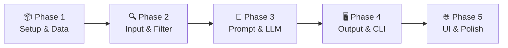

# Implementation Phases — Index

> **Project:** Zomato-1 · AI-Powered Restaurant Recommendation System  
> **Total Phases:** 5  
> **References:** [Problem Statement](../problemstatement.md) · [Architecture](../architecture.md)

---

## Phase Map

| # | Phase | Key Deliverable | Est. Effort | File |
|---|---|---|---|---|
| 1 | Setup & Data Pipeline | Clean dataset in memory | 1–2 days | [phase-1-setup-data.md](./phase-1-setup-data.md) |
| 2 | Input Parsing & Filter Engine | Filtered candidate list from preferences | 1–2 days | [phase-2-input-filter.md](./phase-2-input-filter.md) |
| 3 | Prompt Builder & LLM Integration | Ranked AI recommendations with explanations | 1–2 days | [phase-3-prompt-llm.md](./phase-3-prompt-llm.md) |
| 4 | Output Formatter & CLI | End-to-end working CLI app | 1 day | [phase-4-output-cli.md](./phase-4-output-cli.md) |
| 5 | Streamlit UI & Hardening | Web UI + full test suite + README | 1–2 days | [phase-5-ui-polish.md](./phase-5-ui-polish.md) |

---

## Condensed Checklist

### Phase 1 — Setup & Data
- [ ] Project folder structure created
- [ ] `requirements.txt` written and installed
- [ ] `.env.example` created
- [ ] `src/data/loader.py` implemented
- [ ] `src/data/preprocessor.py` implemented
- [ ] Phase 1 milestone verified ✅

### Phase 2 — Input & Filter
- [ ] `src/input/parser.py` — `UserPreferences` + `parse_preferences()` implemented
- [ ] City alias map populated
- [ ] `src/filter/engine.py` — `get_candidates()` with 4-stage logic implemented
- [ ] Phase 2 milestone verified ✅

### Phase 3 — Prompt & LLM
- [ ] `src/prompt/templates.py` — `SYSTEM_PROMPT` + `USER_PROMPT_TEMPLATE` written
- [ ] `src/prompt/builder.py` — `build_prompt()` implemented
- [ ] `src/llm/client.py` — `call_llm()` with retry + fallback implemented
- [ ] `src/llm/parser.py` — `parse_response()` with 3-attempt parse implemented
- [ ] Phase 3 milestone verified ✅

### Phase 4 — Output & CLI
- [ ] `src/output/formatter.py` — `render_cli()` with Rich panels implemented
- [ ] `src/main.py` — full pipeline wired, interactive + non-interactive + `--dry-run`
- [ ] Phase 4 milestone verified ✅

### Phase 5 — UI & Polish
- [ ] `app.py` — Streamlit UI implemented
- [ ] `render_streamlit()` implemented in `formatter.py`
- [ ] All 6 error edge cases handled in CLI + UI
- [ ] `tests/test_integration.py` written and passing
- [ ] `pytest tests/ -v` — all tests pass
- [ ] `README.md` written with screenshots
- [ ] Phase 5 milestone verified ✅
